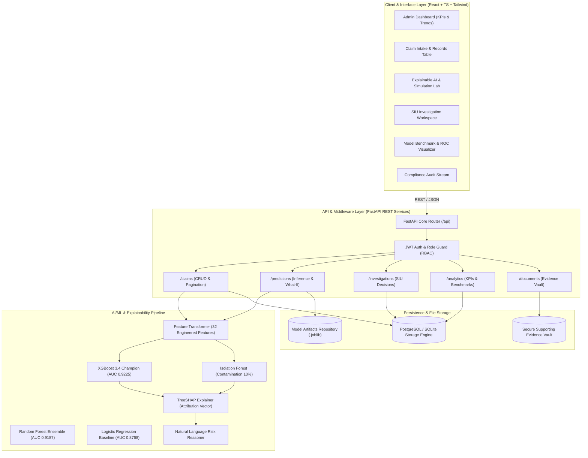
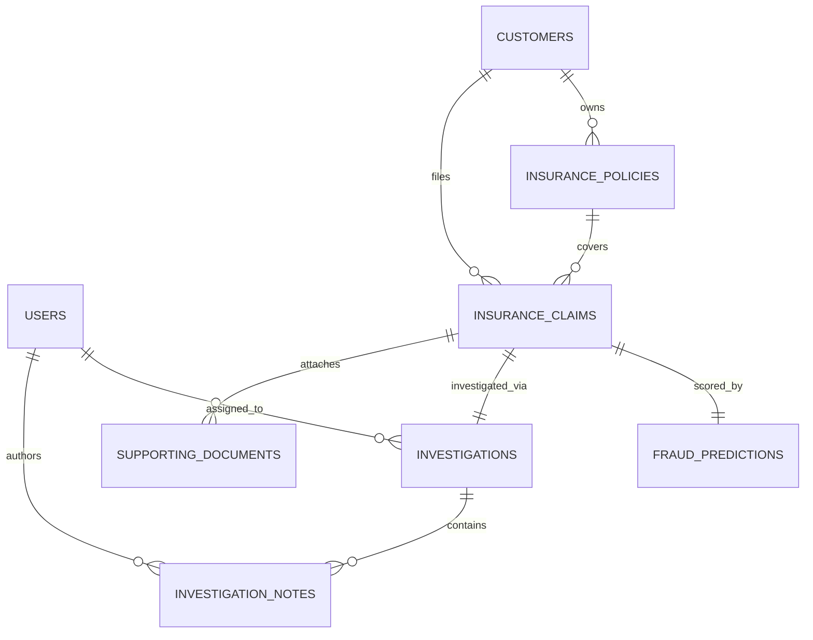

# System Architecture & Technical Specifications

**AI-Powered Insurance Fraud Detection System (InsureGuard AI)**  
*Enterprise Special Investigation Unit (SIU) Surveillance & Explainable AI Platform*

---

## 1. High-Level Architecture Overview

---

## 2. Machine Learning Pipeline & Model Selection

### 2.1 Model Comparison & Selection Criteria
The system implements a multi-model comparative architecture trained on a rigorously validated 12,000-record dataset using an 80/20 stratified split to eliminate data leakage:

| Algorithm | Role | ROC-AUC | F1-Score | Precision | Recall | Key Strength |
| :--- | :--- | :---: | :---: | :---: | :---: | :--- |
| **XGBoost Classifier** | **Champion Model** | **0.9225** | **0.5455** | **0.5017** | **0.5975** | Optimal non-linear pattern capture & scale-invariant splitting |
| **Random Forest** | Challenger | 0.9187 | 0.5585 | 0.5528 | 0.5643 | Robust against localized noise and variance |
| **Logistic Regression** | Linear Baseline | 0.8768 | 0.4289 | 0.2912 | 0.8133 | Fast baseline with class-weight rebalancing |
| **Isolation Forest** | Unsupervised Anomaly | *N/A* | *N/A* | *N/A* | *N/A* | Flags zero-day multi-dimensional outliers without ground-truth labels |

### 2.2 Feature Engineering Taxonomy
The feature extraction pipeline derives **32 numerical and one-hot encoded variables**:
- **Timing & Velocity Drivers**: `policy_age_days` (inception proximity), `submission_delay_days` (reporting lag), `incident_weekend`, `incident_hour`.
- **Financial Proportionality**: `claim_to_coverage_ratio` (limit proximity), `claim_to_income_ratio` (financial distress correlation), `previous_claim_payouts`.
- **Corroborating Evidence Signals**: `police_report_filed` (official report presence), `witness_present`, `supporting_documents_count`.
- **Historical Frequency**: `number_of_previous_claims` (repeat submission velocity).

---

## 3. Explainable AI (SHAP) Formulation

To eliminate black-box opacity and provide actionable decision support, the system utilizes **TreeSHAP (Tree-based SHapley Additive exPlanations)**.

For an individual claim feature vector $x$:
$$\text{Risk Score}(x) = \phi_0 + \sum_{i=1}^{M} \phi_i(x)$$

Where:
- $\phi_0$ represents the base expected fraud value across the training population.
- $\phi_i(x)$ is the Shapley value of feature $i$, indicating its additive contribution.
- Positive $\phi_i > 0$: Increases fraud suspicion (highlighted in Crimson / Red).
- Negative $\phi_i < 0$: Mitigates suspicion / protective factor (highlighted in Emerald / Green).

### Human-Verifiable Checklist Generation
SHAP contribution vectors are automatically converted into an investigative verification protocol:
1. **Policy Inception Proximity ($\le 30$ days)** $\rightarrow$ Cross-reference prior policy lapses in industry clearinghouses.
2. **Limit Saturation ($\ge 85\%$ coverage limit)** $\rightarrow$ Request verified purchase receipts and independent third-party appraisals.
3. **Severe Damage without Police Report** $\rightarrow$ Request 911 dispatch records or official fire logs.

---

## 4. Ethical AI, Fairness & Regulatory Compliance

1. **Human-in-the-Loop Imperative**: The system strictly forbids automated claim denial. Machine learning outputs serve exclusively as decision-support alerts for human SIU investigators.
2. **Prohibition of Protected Attribute Biases**: Individual demographic traits (age, gender, ethnicity) or geographic location alone are never treated as proof of fraud. Explanations focus solely on verifiable behavioral anomalies and documentation gaps.
3. **Auditing & Traceability**: Every model prediction, investigator note, status transition, and evidence upload is recorded with UTC timestamps and user attribution in an immutable `audit_logs` table.

---

## 5. Database Schema & Entities

The relational database architecture is defined in `database/schema.sql`:

---

## 6. Role-Based Access Control (RBAC) Matrix

| Permission / Action | Admin | Fraud Investigator | Claims Officer |
| :--- | :---: | :---: | :---: |
| View Dashboard KPIs & Global Trends | Yes | Yes | Yes |
| Search & Browse Claims | Yes | Yes | Yes |
| Intake New Claims | Yes | Yes | Yes |
| View SHAP Explainability & Risk Decompositions | Yes | Yes | Yes |
| Run Interactive What-If Simulation Lab | Yes | Yes | Yes |
| Assign Investigations to Staff | Yes | Yes | No |
| Add Investigator Notes & Attach Evidence | Yes | Yes | Yes |
| **Record Final Outcomes (Confirmed Fraud / Legitimate)** | **Yes** | **Yes** | **No** |
| Access Algorithm Benchmarks & ROC Curves | Yes | Yes | Read-Only |
| View Compliance Audit Logs | Yes | Yes | No |
